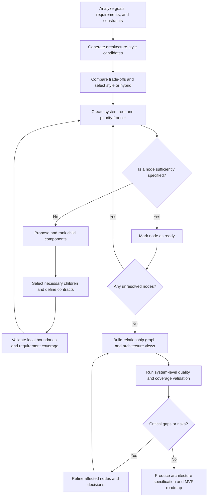

# Adaptive Recursive Architecture Design (ARAD)

**Status:** Design proposal / initial algorithm specification  
**Date:** 2026-11-04  
**Goal:** A reusable process for designing software architecture across many application types and architectural styles.

## 1. Problem statement

Given a description of a software application, its functional requirements, quality attributes, constraints, and environment, construct an architecture that is appropriately decomposed, explains interactions and data ownership, and can be validated against those requirements.

The core idea is to repeatedly ask:

> What are the most important components or subcomponents of this system (or of this component), and what should each one contain?

Let `X, Y, Z, Q, ...` denote the number of children selected at successive decomposition steps. Rather than prescribing a common `X`, `Y`, `Z`, or `Q` for all branches, decide independently for each node how much decomposition is valuable.

This method aims to support *many kinds* of architecture, but cannot guarantee a complete or correct design by decomposition alone. Requirements discovery, cross-cutting decisions, interfaces, interactions, quality trade-offs, and validation remain necessary.

## 2. Core model: a tree plus a graph

Represent the architecture as two linked structures:

1. **Decomposition tree:** `System → Subsystem → Component → Module → Unit` (descriptive levels, not mandatory rigid tiers).
2. **Relationship graph:** calls, dependencies, data flows, events, shared resources, deployment connections, trust boundaries, and ownership relationships.

A component `v` can be decomposed into `k(v)` children:

```text
A(v) = {c1, c2, ..., c_k(v)}
0 <= k(v) <= 10
```

- `k(v) = 0`: the component is sufficiently specified and becomes a leaf.
- `1 <= k(v) <= 10`: the component needs further decomposition.
- **3–7 children** is a useful initial presentation target, not an invariant.
- If a domain genuinely requires more than ten distinct responsibilities, use a well-justified grouping or allow the schema to relax the display cap; never silently discard mandatory responsibilities.
- Different branches may have different depths.

The tree answers *what is contained where*. The graph answers *how pieces interact*. Both are required.

## 3. Pipeline



### Stage 1 — Understand the application

Collect and classify:

- Actors, users, core use cases, workflows, and external integrations.
- Functional requirements and explicit exclusions.
- Quality requirements, preferably measurable: latency, throughput, availability, recoverability, safety, security, privacy, maintainability, and cost.
- Constraints: team expertise, budget, cloud/on-premises/hardware, compliance, technology, existing assets, and deadlines.
- Assumptions, unknowns, and success/acceptance criteria.

Missing information must be captured as an assumption, open decision, or question; it must not be invented as an established fact.

### Stage 2 — Generate and assess architecture candidates

Compare two or three plausible architecture styles, if more than one is reasonable. Choose on the basis of requirements, likely change, operational capacity, data consistency, deployment needs, scaling patterns, and cost.

A system may legitimately combine styles (for example, a modular monolith using hexagonal boundaries and event-driven integration).

### Stage 3 — Adaptive recursive decomposition

For each node:

1. Define the node's responsibility, scope, invariants, and applicable requirements.
2. Determine whether further decomposition would improve implementation clarity or reduce risk.
3. Generate candidate child components.
4. Rank candidates for architectural attention, but **retain all mandatory functional coverage**.
5. Select justified children and assign ownership/responsibilities.
6. Specify interfaces, inputs/outputs, data, dependencies, errors, and relevant quality targets.
7. Validate the local decomposition (cohesion, coupling, completeness, overlap, and cycles).
8. Recurse into unresolved/high-risk children.

### Stage 4 — Model inter-component relationships

Capture at least:

- Synchronous APIs and asynchronous events; producer/consumer semantics.
- Data ownership, schema boundaries, consistency and transaction assumptions.
- Dependency direction and allowed/forbidden dependencies.
- Failure modes, retry/idempotency, timeouts, recovery paths, and backpressure when relevant.
- Identity, authorization, trust boundaries, secrets, and auditability.
- Runtime/deployment boundaries, environment configuration, and observability.

### Stage 5 — Validate

Assess mandatory use-case coverage and cross-cutting quality attributes with evidence. Use scenarios, threat analysis, proof-of-concept experiments, trade-off records, benchmarks, or reviews as appropriate. Prioritize critical failures and revisit affected decisions or subtrees.

### Stage 6 — Produce implementation guidance

Emit an architecture specification, diagrams, architecture decision records (ADRs), open risks and assumptions, interface contracts, acceptance tests, and a prioritized MVP/implementation roadmap.

## 4. Component priority heuristic

An initial proposal for *design attention* (not a claim of universal optimal weights):

```text
P(c) = 0.30 V + 0.25 R + 0.20 D + 0.15 Q + 0.10 U
```

Each term is scored 0–10:

| Term | Meaning |
| --- | --- |
| `V` | Value to primary users and core capabilities |
| `R` | Risk/impact of being wrong, missing, or failing |
| `D` | How many other parts depend on this component and how critically |
| `Q` | Influence on quality attributes such as reliability or security |
| `U` | Uncertainty requiring early architectural investigation |

Do not confuse **design priority** with **build order**. A difficult authentication boundary may need early investigation even when a different feature is built first. Critical requirements may never be excluded merely because their numeric scores are lower. Weights need calibration by domain and constraints.

A better implementation can add separate scores for *mandatory coverage*, *design urgency*, *implementation value*, and *effort*, along with hard constraints.

## 5. Depth guidance and growth control

These ranges are planning heuristics, not rules:

| Context | Usually useful decomposition depth |
| --- | --- |
| Small script or utility | 1–2 |
| Small web/mobile MVP | 2–3 |
| Medium application | 3–4 |
| Large enterprise/distributed system | 4–6 for selected areas |
| Highly regulated, safety-critical, or hardware-constrained system | As required by traceability and verification |

Avoid uniform decomposition to depth `Q`: the node count can explode. For a full `b`-ary tree with depth `d` edges, total nodes = `(b^(d+1)-1)/(b-1)` for `b>1`. At branching factor five, four rounds yield **781 nodes**, five rounds **3,906 nodes**.

Therefore use:

- A **priority frontier** to tackle consequential gaps first.
- A **stop predicate** rather than fixed depth.
- **Budgets** for complexity, iteration count, time, and unresolved uncertainty.
- A **review state** for unresolved questions if limits are reached: a bounded algorithm must not claim validation passed merely because it stopped running.

## 6. Stop predicate

Stop decomposing an individual node when all applicable conditions have evidence or explicit acceptance:

1. Responsibility and boundary are unambiguous.
2. Inputs, outputs, interfaces, errors, and contracts are specified.
3. Dependencies, data ownership, and invariants are known.
4. Relevant quality and security requirements are accounted for.
5. Important risks and decisions are resolved, accepted, or intentionally deferred with ownership.
6. A developer or team could implement and test this node without further *architectural* decomposition.

For the architecture as a whole, additionally require:

- Every mandatory requirement maps to at least one component, interaction, and verification case.
- End-to-end use cases, failure paths, and integrations are represented.
- Quality/scaling/security/deployment risks have been evaluated.
- No unowned data or critical responsibility is left unresolved.
- Significant trade-offs and decisions are recorded.
- Stakeholders accept remaining documented uncertainties.

**Ready** means sufficiently specified for the agreed scope, not formally proven universally correct.

## 7. Architecture styles this method can support

| Style | Typical decomposition emphasis |
| --- | --- |
| Monolith | Cohesive internal modules, interfaces, functions/classes |
| Modular monolith | Domain/module boundaries; enforced dependencies |
| Microservices | Business capability ownership, bounded contexts, independent deployment, service contracts |
| Layered/N-tier | Presentation, application, domain, persistence and their dependencies |
| Clean/hexagonal | Domain model, ports, adapters, direction of dependencies |
| Event-driven | Producers, consumers, events, schemas, delivery/failure semantics |
| Serverless | Functions, triggers, orchestration, managed services, state |
| Service-oriented architecture (SOA) | Service contracts, orchestration, integration patterns |
| Microkernel/plugin | Stable core, extension contracts, plugins |
| Pipe-and-filter | Stages, transformation boundaries, intermediate data |
| Distributed/HPC | Data partitioning, scheduling, coordination, resource management |
| AI/agentic systems | Model boundaries, tools, state, orchestration, evaluation, safety and human oversight |
| Embedded/real-time | Hardware interfaces, timing/resource budgets, concurrency and fault/safety constraints |

The recursive **process** is reusable; the rules for good **boundaries, interfaces, and validation** are style- and domain-specific.

## 8. Required architecture views

A decomposition tree alone is not an architecture. Generate at least these views where relevant:

1. **Structural:** modules, components, ownership, boundaries, dependencies.
2. **Runtime:** sequence diagrams, workflows, events, concurrency, failures.
3. **Data:** logical entities, persistence, ownership, transactions, retention.
4. **Deployment:** processes, nodes, cloud resources, scaling, environments.
5. **Quality/security:** trust boundaries, quality scenarios, observability, resilience, compliance.

Useful references for structuring these views include C4, arc42, and ISO/IEC/IEEE 42010. They are complementary modeling/documentation practices; their level counts are **not** a mandated recursion depth.

## 9. Worked example: file transfer application

**System:** Secure file-transfer application with multiple storage backends.

**Level 1 — X = 5 candidate subsystems:**

1. Transfer Engine
2. API & User Interface
3. Job Orchestration
4. Storage & Metadata
5. Identity & Access

**Level 2 — inside Transfer Engine, Y = 4:**

1. Protocol Adapters
2. Transfer Planning
3. Execution & Concurrency
4. Retry & Recovery

**Level 3 — inside Protocol Adapters, Z = 3:**

1. POSIX Adapter
2. S3 Adapter
3. HTTP/WebDAV Adapter

**Optional Level 4 — inside S3 Adapter:** Decompose further only if multipart upload, checkpoint recovery, permissions, credential refresh, or error mapping are not yet sufficiently specified.

Other branches may stop at levels 2 or 3. Separately model communication between transfer workers, job orchestration, metadata, and access control.

## 10. Algorithm pseudocode

```python
def design_architecture(requirements, constraints, limits):
    context = analyze_requirements(requirements, constraints)
    options = propose_architecture_styles(context)
    style = evaluate_and_select_style(options, context)

    root = make_root_node(context, style)
    frontier = PriorityQueue()
    frontier.push(root)
    open_questions = []
    iterations = 0

    while frontier and iterations < limits.max_decomposition_steps:
        iterations += 1
        node = frontier.pop_highest_priority()

        if has_sufficient_evidence_to_stop(node, context):
            node.status = "ready"
            continue

        candidates = propose_children(node, context, style)
        children = select_cohesive_children(
            candidates,
            preferred_count=(3, 7),
            display_max=10,
            preserve_mandatory_coverage=True,
        )
        if not children:
            node.status = "blocked"
            open_questions.append(describe_blocker(node))
            continue

        node.children = children
        define_contracts_and_data_ownership(node, children)
        check_local_coverage_and_boundaries(node, children)

        for child in children:
            child.design_priority = priority_score(child, context)
            frontier.push(child, priority=child.design_priority)

    for node in frontier:
        node.status = "requires_review"
        open_questions.append(describe_unfinished_node(node))

    graph = build_relationship_graph(root, context)
    views = generate_architecture_views(root, graph, style)
    findings = validate_system(root, graph, views, context)

    # A real implementation must explicitly bound and log this
    # feedback/refinement loop, recheck impacted requirements,
    # and stop with an unresolved status if risks remain.
    revision = 0
    while findings.has_critical_gaps() and revision < limits.max_revisions:
        revision += 1
        affected = identify_affected_decisions_and_nodes(findings)
        if not refine_affected_nodes(affected, context, limits):
            break
        graph = build_relationship_graph(root, context)
        views = generate_architecture_views(root, graph, style)
        findings = validate_system(root, graph, views, context)

    status = (
        "validated_for_scope"
        if not findings.has_critical_gaps() and not open_questions
        else "incomplete_requires_review"
    )
    roadmap = plan_implementation(root, graph, context, findings)

    return {
        "status": status,
        "style": style,
        "tree": root,
        "graph": graph,
        "views": views,
        "findings": findings,
        "open_questions": open_questions,
        "roadmap": roadmap,
    }
```

This is **illustrative pseudocode**, not production-ready or a proof that the resulting architecture is optimal. Each called function still needs its own specification, implementation, and tests.

## 11. Suggested machine-readable component fields

```json
{
  "id": "transfer.s3_adapter",
  "name": "S3 Adapter",
  "responsibility": "Transfer data to and from S3-compatible storage",
  "parent_id": "transfer.protocol_adapters",
  "architecture_style": "modular_monolith",
  "requirements": ["FR-012", "NFR-SEC-003"],
  "interfaces": [],
  "dependencies": [],
  "owned_data": [],
  "quality_targets": {},
  "risks": [],
  "assumptions": [],
  "validation_evidence": [],
  "children": [],
  "status": "requires_review"
}
```

A separate edge record can describe dependency type, protocol, synchronous/asynchronous semantics, data classification, error behavior, and evidence. A requirement-to-component-to-test traceability map should be maintained throughout.

## 12. Evaluation strategy

To determine whether ARAD actually helps, benchmark it on diverse systems and compare its output with architecture reviews by experienced engineers.

Candidate measures:

- Functional and nonfunctional requirement coverage.
- Number/severity of unaddressed architecture risks.
- Coherence of boundaries and coupling.
- Accuracy and usefulness of runtime/data/deployment views.
- Implementation rework caused by missing decisions.
- Time and artifact size needed to reach a reviewable design.
- Quality of trade-off explanations across architecture candidates.
- Traceability of decisions and ease of incremental updates.

A successful evaluation must show that adaptation helps across styles; universal correctness cannot be inferred from a handful of examples.

## 13. Suggested implementation modules

1. **Requirements Analyzer:** parse, normalize, and trace requirements.
2. **Style Selector:** compare architecture candidates and trade-offs.
3. **Recursive Decomposer:** priority queue, node generation, adaptive stop criteria.
4. **Dependency Modeler:** interfaces, ownership, interactions, architecture views.
5. **Architecture Validator:** use-case coverage, quality scenarios, critical risk gates.
6. **Implementation Planner:** ADRs, implementation-ready specifications, tasks and milestones.

## 14. Open design decisions

- Should `1–10` be a hard model constraint or only a human-readable presentation limit?
- Which quality metrics and threshold evidence determine readiness per domain?
- How should the agent handle ambiguity, conflicting requirements, and stakeholder trade-offs?
- How should scoring weights vary for safety-critical vs. consumer software?
- What is the contract for reproducible, auditable architectural decisions?
- How should human review and overrides be incorporated in the refinement loop?

## 15. References for future implementation research

- [C4 model](https://c4model.com/) — hierarchical architecture visualization.
- [arc42](https://arc42.org/) — architecture documentation structure.
- [ISO/IEC/IEEE 42010 overview](https://www.iso-architecture.org/42010/) — architecture descriptions and viewpoints.
- [SEI ATAM](https://www.sei.cmu.edu/library/architecture-tradeoff-analysis-method-collection/) — quality-attribute trade-off analysis.
- [Microsoft Azure Architecture Center](https://learn.microsoft.com/en-us/azure/architecture/guide/architecture-styles/) — architecture style guidance.

---

**Summary:** Use **adaptive breadth + adaptive depth + explicit interfaces + a relationship graph + multi-view validation + a bounded feedback loop**, not a universal fixed count of recursive questions.
