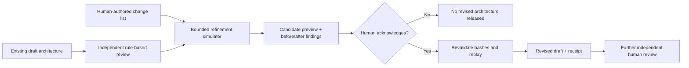

# Phase 5 — Review-driven architecture refinement and reference evaluations

**Status:** Implemented as a deterministic, review-gated prototype.  
**Product boundary:** Speccanopy designs software architectures; it does not write, build, test, or deploy the application being designed.

## Purpose

This milestone connects Phase 3's architecture quality findings to **targeted, bounded design edits**, and adds a transparent, maintainer-curated reference rubric evaluation. It does **not** autonomously invent a revised architecture, independently verify quality, authenticate reviewers, or certify production readiness.

The Phase 4 AI model can still propose a hierarchy, but **its output is not allowed to author approved refinement edits or evidence**. Phase 5 consumes explicitly **human-authored** patch requests, reuses deterministic Phase 3 review checks, and requires another explicit acknowledgement to release a revised draft. A later milestone may propose edits with AI, subject to the same controls.

## Refinement lifecycle



### Allowed changes

The deliberately narrow patch schema supports:

- `add_interface`: a directional, typed contract for a referenced component
- `add_relationship`: a typed component relationship, with optional requirement links
- `set_quality_target`: a stated quality target for an existing requirement owner
- `remove_duplicate_data_owner`: choose the remaining canonical owner among two sibling claims
- `add_requirement_link`: assign an explicit requirement to a responsible component
- `add_verification_plan`: add a *planned* architecture verification case, never fabricated verified evidence

Each patch has a stable ID, round number, rationale, current Phase 3 finding ID/category and strictly validated payload. Unknown fields and cross-object references fail validation. Patches cannot set `validated_for_scope`, add successful verification evidence, accept architecture decisions, change implementation source code, or silently close open source risk findings.

### Bounded and fail-closed controls

- Input constraints' `max_refinement_rounds` limits review/patch cycles. If it is zero, no refinement is allowed. A plan has at most 64 changes and contiguous rounds.
- Before each round, every patch must identify a real finding from the **current** review. The action must match the finding category and, where supplied, its affected components and requirements.
- After a round, Speccanopy reparses the full architecture through Pydantic and reruns quality review. It refuses new uncovered mandatory requirements and any **increase in high/critical findings**. New medium/low findings are still reported; the guard cannot replace expert analysis.
- Changed components and ancestors lose their prior structural-ready state and review evidence. Verification cases tied to those components are downgraded from `verified` to `planned`; stale evidence is not silently carried forward.
- Preview includes SHA-256 digests of the source architecture, review config and candidate. The apply command replays the edit sequence and rejects a changed source, config, edits, plan summary or preview.
- Applying requires a nonempty `--reviewer` and `--acknowledge-review`. The reviewer name is **self-declared**, not authenticated. No approval receipt is checked into example snapshots.
- Even after acknowledgement, the revised architecture is always `incomplete_requires_review` and cannot be presented as independently validated.

This is *controlled, targeted revision of an authored architecture*, not automatic discovery of a correct design or complete targeted autonomous redesign.

## Example: e-commerce interface contracts

Existing [e-commerce draft](../examples/generated/ecommerce/architecture.json) has three rule-detected missing interaction-contract findings. A curator supplies [five change proposals](../examples/refinement/ecommerce.edits.json) across two rounds, targeting order/payment, order/inventory, and lifecycle/tracking communication.

```bash
# Install the CLI and run tests (Python 3.11+)
python -m pip install -e '.[dev]'
pytest -q

# 1. Produce an UNAPPROVED preview, not a release.
speccanopy refine-plan \
  examples/generated/ecommerce/architecture.json \
  --config examples/ecommerce.review.json \
  --edits examples/refinement/ecommerce.edits.json \
  --output out/refinement-preview

# 2. Inspect the plan, before/after findings and changed architecture.
#    Only an actual human review should authorize the next command.

# 3. Optional: acknowledge and release a revision FOR FURTHER REVIEW.
speccanopy refine-apply \
  examples/generated/ecommerce/architecture.json \
  --config examples/ecommerce.review.json \
  --plan out/refinement-preview/refinement-plan.json \
  --reviewer YOUR_REVIEWER_ID \
  --acknowledge-review \
  --output out/refinement-reviewed

# 4. Compare the source and an UNAPPROVED preview against a curated rubric.
speccanopy benchmark \
  examples/generated/ecommerce/architecture.json \
  --candidate out/refinement-preview/candidate-preview.json \
  --config examples/ecommerce.review.json \
  --rubric examples/refinement/ecommerce.rubric.json \
  --output out/refinement-benchmark
```

The reproducible **unapproved** preview and reports are in [`examples/refinement/generated/ecommerce`](../examples/refinement/generated/ecommerce). Baseline review detects 3 interaction-contract findings; after round one it detects 1; after round two it detects 0. **Planned architecture verification and quality scenario evidence are still outstanding.** The candidate is not claimed to be secure or complete.

## Reference rubric evaluation (not certification)

`benchmark` evaluates a **human-authored, domain-specific structural reference rubric**. Criterion types are component presence, typed interaction presence, directional interface presence, quality target presence, a scenario with no deterministic design gaps, and a linked architecture verification case (which may be only planned). Scores are weighted **criterion presence**, not correctness, reliability, threat resistance, or actual expert validation.

A reference rubric has source provenance and a status:

- `curated_unreviewed`: authored for reproducibility, not independently reviewed (all current examples).
- `reviewer_attested`: a reviewer identifier must be supplied, but that identifier is self-declared and **not cryptographic proof of expertise or approval**.

The benchmark reports criterion-by-criterion presence, unmatched criteria, coverage gaps, high/critical review findings and any before/after score difference. **100% on this rubric does not imply an implementation-ready or independently validated architecture.** Different valid architectural designs may intentionally use different component IDs, boundaries or styles; these small rubrics do not measure universal design quality.

### Reproducible example results

| Example | Criterion coverage | Interpretation |
| --- | ---: | --- |
| CLI utility (curated original) | 100% (7/7) | Its narrow documented structural expectations are represented; independent review still needed |
| E-commerce before targeted changes | 51.22% (6/11) | Five missing directional interfaces in reference expectations |
| E-commerce **unapproved preview** | 100% (11/11) | All authored structural criteria represented after five proposed interface edits |
| File-transfer (curated original) | 79.31% (6/8) | Intake→planner event producer/consumer contracts still missing |

The e-commerce **+48.78 percentage-point change** is a demonstration of *local rubric coverage*. No empirical benchmark of AI reasoning or professional architect judgement has been conducted yet. The CLI baseline's 100% score likewise does not mean that its planned verification evidence was completed.

## New files and output structure

- `src/speccanopy/refinement.py`: narrow edit models, finding binding, two-pass replay, invalidation and acknowledgement receipt
- `src/speccanopy/benchmark.py`: referenced criteria, evaluation and comparison, transparent provenance
- `src/speccanopy/refinement_exporters.py`: preview, receipt and benchmark exports
- `tests/test_refinement.py`, `tests/test_benchmark.py`, `tests/test_phase5_examples.py`: deterministic model/CLI/integrity/regression tests
- `examples/refinement/*.json`: patch examples and curated, **unreviewed** reference criteria
- `examples/refinement/generated/`: reproducible preview and benchmark snapshots; no fictional human approval receipt

`refine-plan` produces `refinement-plan.json`, `candidate-preview.json`, `review-before.json`, `review-after.json`, and `refinement-plan.md`. `refine-apply` produces a revised `architecture.json`, a `refinement-receipt.json`, and `review-after.json`. `benchmark` produces `reference-benchmark.json` and `reference-benchmark.md`.

## Scope deliberately not claimed

- No automatic semantic rewrite of components, complete design alternatives, or AI-driven targeted critique.
- No independently performed expert review; only maintainer-curated reference rubrics and review-ready records.
- No architecture source authentication or cryptographic human-review attestations.
- No automatic validated status; explicit high-risk and missing verification findings persist.
- No target application compilation, execution, testing or deployment.

**Next:** obtain independently reviewed reference architectures across additional domains, compare candidate designs to multiple valid alternatives, improve semantic quality evaluation, and consider AI-authored *proposals* for refinements without relaxing deterministic guards or human approval.
